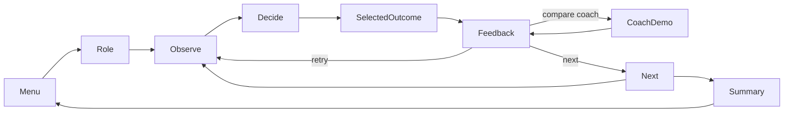

# Soccer Smart Lab design

Status: implemented and expanded on 2026-11-07. This document records the
original starter design; its staged backlog is historical. The current
[coverage audit](BOOK_COVERAGE.md) maps 57 public-index entries to the runnable
starter and Book companion modes. All activities remain ORIGINAL; chapter
bodies are not verified. [SOURCES.md](SOURCES.md) records the evidence boundary.

## Player and learning promise

John chooses how one player responds to a visible soccer situation. He learns
to notice pressure, available space, teammates and possession before acting.
The playable role rotates between defender, midfielder, winger and forward;
the player marker still says JOHN. A short role card states what matters in
this picture rather than requiring a formation to be memorized.

Use the existing project's age-nine profile as the reading target. Broader
8-12 accessibility is a design intention, not a tested age range. Keep the main
cue under 24 words, action labels under 12 words and each coaching explanation
under 24 words. Put source provenance and detailed adult notes outside play.

The game evaluates decisions in authored pictures. It cannot measure actual
first-touch skill, kick technique, speed, fitness or real-match improvement.
It also cannot certify book fidelity while chapter bodies remain unreviewed.

## First-release menu

Four independent cards open the four sections in CURRICULUM.md. A fifth card
offers a mixed round once its scheduler is implemented and checked. A separate
Practice cards link opens unscored demonstrations and adult activities. The
design's later book themes are not displayed as playable unfinished content.

```text
SOCCER SMART LAB                         Sound / Menu
Your role: midfielder     Attack toward the top goal

+--------------------------------+ +-------------------------+
|                                | | PLAY 2 / 8              |
| full pitch, visible players    | | What can you see?       |
| and moving ball                | | A closes from your right|
|                                | |                         |
| hover: chosen intent only      | | 1  Touch into left space|
| feedback: chosen / suggested   | | 2  Touch toward A       |
| route and short consequence    | | 3  Return to BACK       |
+--------------------------------+ +-------------------------+
Practice first tries: 1 / 1        No decision countdown
```

This is a layout sketch, not a screenshot or tested pixel specification.
Retain a resizable 1280x880 logical canvas as a starting point. Use at least
64-pixel action targets, visible keyboard focus and click/keyboard parity.
Measured-text checks cover all cues, choices and feedback at the final layout.

## Learning loop



1. State role, possession and attack direction. A diagram key introduces JOHN,
   named blue teammates and orange opponents. Icons and labels supplement color.
2. Show about two seconds of the preceding play, with pause/replay available.
   Stop at the decision frame; the cue describes observable facts.
3. Present three shuffled concrete actions. Mouse hover or keyboard focus shows
   that action's intent, never a grade, recommended route or answer glow.
4. Animate the selected action from the actual decision-frame ball and actors.
   A risky choice gets its own plausible consequence, not the preferred demo.
5. Show its grade, a picture-specific reason and a separate compare-coach button.
   Coach routes use a different line pattern and label as well as color.
6. Retry freely, replay either illustration, or continue. The first attempt
   remains the scored attempt even after a successful retry.

Decide and Feedback have unlimited time. Skipping animation moves only to its
next phase and never submits an answer. Inactive buttons/keys do not change the
scene or record a result. Escape returns to the menu; quitting closes cleanly.

## Rounds, transfer and scoring

Each of the four sections has three topics and nine planned base scenes.
For a section round, sample two variants per topic for six practice scenes.
Hold out the remaining variant per topic, then take two from different topics
for the final transfer layouts. This yields eight distinct base IDs. Apply an
approved geometric layout change only after verifying that its facts and
decision grades still make sense. Do not call a seen A scene unseen merely
because its coordinates were moved.

Use an explicit seed for reproducibility. A fresh ordinary launch can vary
order and option positions. A mixed round takes six distinct practice scenes
covering all four sections, then two unused variants from represented topics.
Track held-out base IDs before any transforms. Test reachability across seeds.

Grade 2 means a strong fit, 1 means reasonable and 0 identifies a visible risk.
There can be multiple reasonable options, including multiple strong options
when the picture warrants them. Never force three different preferred actions
just to produce variety. Successful reception and scoring remain uncertain.

Count grades 1 and 2 positively on the first attempt. Report practice and
transfer results separately. Completion badges celebrate finishing a topic;
they are independent of first-try correctness. Replays, retrying and clicking
celebrations never add scored results. Avoid streak penalties, public rankings
or rewards for reading faster. A few minutes is a pacing goal, not a timer.

## Engagement that serves the lesson

- One mini-mission per round, such as finding support for a pressed teammate.
  Vary role, possession and pressure instead of only repainting the same puzzle.
- A short optional prediction pause: point to the pressure or open receiver
  before selecting an action. Pointing is unscored and does not reveal grades.
- Replay selected and coach actions from the same frozen starting facts.
  A before/after toggle identifies the fact that changes a B/C variant.
- Gentle generated selection, ball-contact and completion sounds, with a
  persistent in-session mute control. Missing audio must not stop play.
- Optional short humorous captions can depend on action type, not whether an
  option is correct. Keep the real action label readable and avoid ridicule.
- A small celebration stays in the header after feedback. No confetti, badge
  or mascot may obscure the decision ball, player labels or passing lanes.

An optional unscored ball toy can later live on the menu/summary, as in Luke's
game. It is not a prerequisite for releasing the first tactical lesson. Test
with John: can he name the changing fact, and does he want another round?
Observe those outcomes without claiming that software tests establish fun.

## Whole-field scene contract

Use normalized full-field coordinates: x=0 is screen left; y=0 is the attacking
goal; y=100 is John's goal. JOHN's team attacks upward for all MVP pictures.
Show both goals and a halfway line at y=50. State the orientation every time.
These coordinates are illustration units, not meters or player-speed claims.

John's current renderer shows the defensive half, with midfield at its top.
Reusing that pitch unchanged would mislabel the new attacking pictures.
Likewise its model has hard-coded topic limits, a mandatory John actor and a
fixed own-goal transfer transform. Treat those as current constraints, not a
ready-made general attacking model. [J1-J3 in SOURCES.md](SOURCES.md)

Proposed future data responsibilities:

| Record | Essential fields and invariant |
|---|---|
| BookLink | source ID, group ID, locator, evidence status, reviewer and reviewed edition; theme link is separate from coaching approval |
| Actor | stable ID, team, role, decision position, preceding path, facing and readiness; all remain identifiable across phases |
| Situation | topic/base/variant IDs, controlled actor, role, possession, attack goal, observable cue, actors and ball state |
| BallState | owner or loose/in-flight status, position, prior path and height; ownership cannot silently change during a dribble |
| Choice | stable key, literal label, actor path, intended ball path/release, receiver or space target, grade and specific reason |
| Demonstration | authored segment order and contact/release moments; selected consequence is separate from coach illustration |
| RuleProfile | explicit competition configuration and capability flags; absent facts are unconfigured, not guessed |
| Review | author, evidence status, coach review status, visible-fact checklist and unresolved issues |

Keep actor movement and ball destination separate. A pass preview goes to the
receiver while John's support step can end elsewhere. The ball stays with the
player until contact and release. Named receivers must be visible, ready when
claimed, and reachable by the intended clear lane. A rolling or long delivery
is an attempt, not a guarantee of possession.

Pausing and skipping use the same scene/segment state as ordinary animation.
Actors that are not scripted to move hold their decision positions; no player
teleports to justify a grade. A coach demo can illustrate teammates cooperating
but must label that continuation as one possibility. Do not fake physical
contact, tackle safety or a perfect pass from every choice.

## Rule and technique boundaries

MVP uses open-play situations. Offside and restart lessons stay in the later
curriculum until an adult supplies their competition profile and a current
rule reference is checked. Do not derive them from the 2016 book or infer a
format from John's age. A build-out line belongs only in a configured picture.

The initial John profile excludes heading prompts and contested aerial tasks.
G07 remains accounted for in the plan, with review pending. Technical animation
is an explanation tool; practice cards are unscored adult-led suggestions.
No confidence, nutrition, fitness or injury diagnosis is made from game scores.

## Implementation boundaries

The future application belongs in this directory and should launch separately.
This delivery creates no runtime entry point and adds no dependency.

| Planned module | Responsibility | Existing reference |
|---|---|---|
| model / geometry | Role-aware scene facts, coordinates, path and identity validation | [John model](../john/model.py), studied rather than imported unchanged |
| curriculum / content | Canonical topic membership, original variants and provenance | [John curriculum](../john/curriculum.py) and [content](../john/content.py) |
| catalog | Resolve named actors, intended targets and reviewed grades | [John catalog](../john/catalog.py) |
| session | Playlist, phase transitions, first attempts, retry and summary | [John session](../john/session.py) |
| presentation | Selected action and coach segment timing; no renderer import | [John presentation](../john/presentation.py) |
| drawing / app | Full-field drawing, text measurement and input adapters | [John app](../john/app.py) and [drawing](../john/drawing.py) |

Initially use independent game records so new attacking roles cannot change
John's published catalog. Reuse small proven primitives only when their
contracts match, with contract tests. Do not copy the whole John package or
start a shared-engine refactor merely to deliver the first scene. If common
code is later extracted, treat it as an explicit migration with both games'
tests and preservation checks.

## Delivery slices and release gates

1. **This delivery:** English design, public-theme map, twelve worked original
   examples, 24 contrast briefs, sources, approval record and document evidence.
2. **Vertical slice:** implement T01.A, selected-action feedback and retry with
   real drawing. Author/review T01.B/C before claiming context transfer. No
   star, tooltip, option order or overlay may reveal the answer before choice.
3. **Tactical MVP:** fully author the other 33 scenes, complete review records
   for all 36, implement all four sections and prove the six-plus-two scheduler.
   The current 24 briefs are not ready-to-play content.
4. **Book-companion review:** verify every used chapter body and edition,
   resolve disagreements, and coach-review the gameplay. Technical cards and
   advanced rule themes expand only after their own acceptance review.

Future executable acceptance names:

- `context_changes_decision`: visible facts, not grades, drive the contrasted
  scenes; options explain their own benefit/risk and allow reasonable choices.
- `paths_match_intent`: actor/ball endpoints, receiver IDs, contact timing and
  possession match each choice and every animation phase.
- `decision_has_no_answer_leak`: all hover/focus states and option orders keep
  coach overlays, grades and celebrations hidden until feedback.
- `round_has_held_out_variants`: seeds produce six balanced practice IDs and
  two genuinely unused variants; transformed IDs retain their base identity.
- `retry_preserves_first_attempt`: every phase transition and invalid input
  respects saved results and practice/transfer separation.
- `provenance_is_honest`: each scene references a valid theme and review status;
  INDEX_ONLY entries cannot be relabeled as reviewed book instructions.
- `real_controls_and_layout`: all authored scenes and three choices render
  without overflow; keyboard/mouse, resizing, mute and quit work in real SDL.
- `preserve_existing_games`: both original game inventories and suites pass
  before any future extraction or shared-code edit.

Release evidence must include meaningful property/geometry checks, types,
lint/format, changed behavior coverage, applied mutants, a repeatable smoke and
child/coach playtest notes. This document's checks validate a design package;
they cannot be reported as a working-game test pass.
